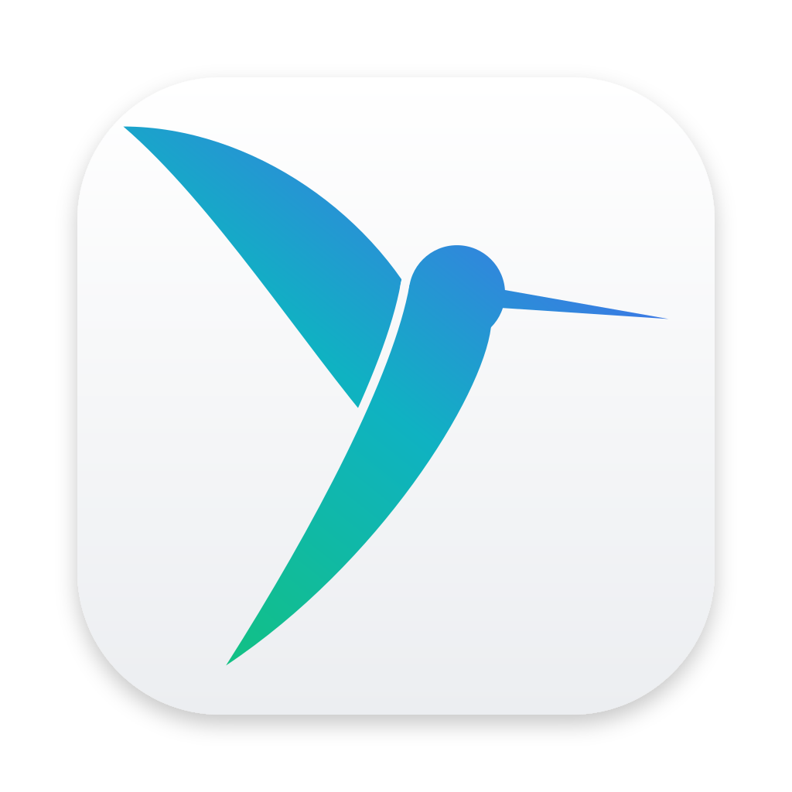
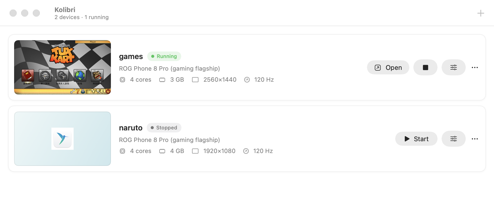
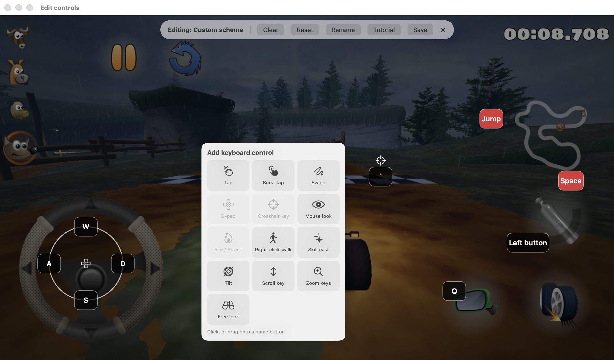
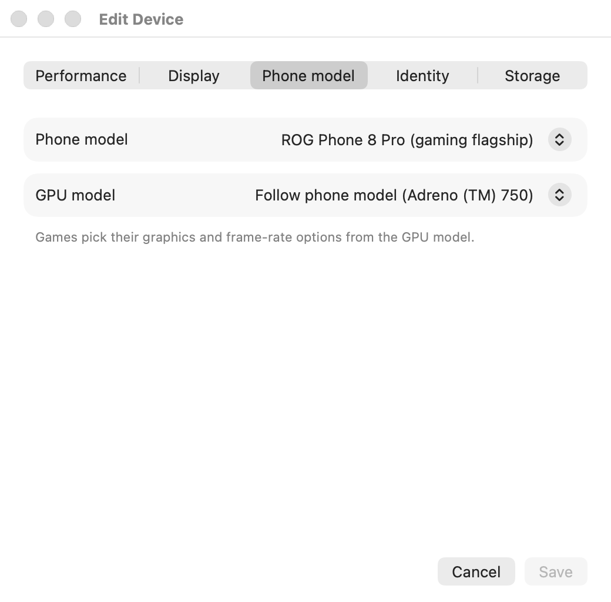
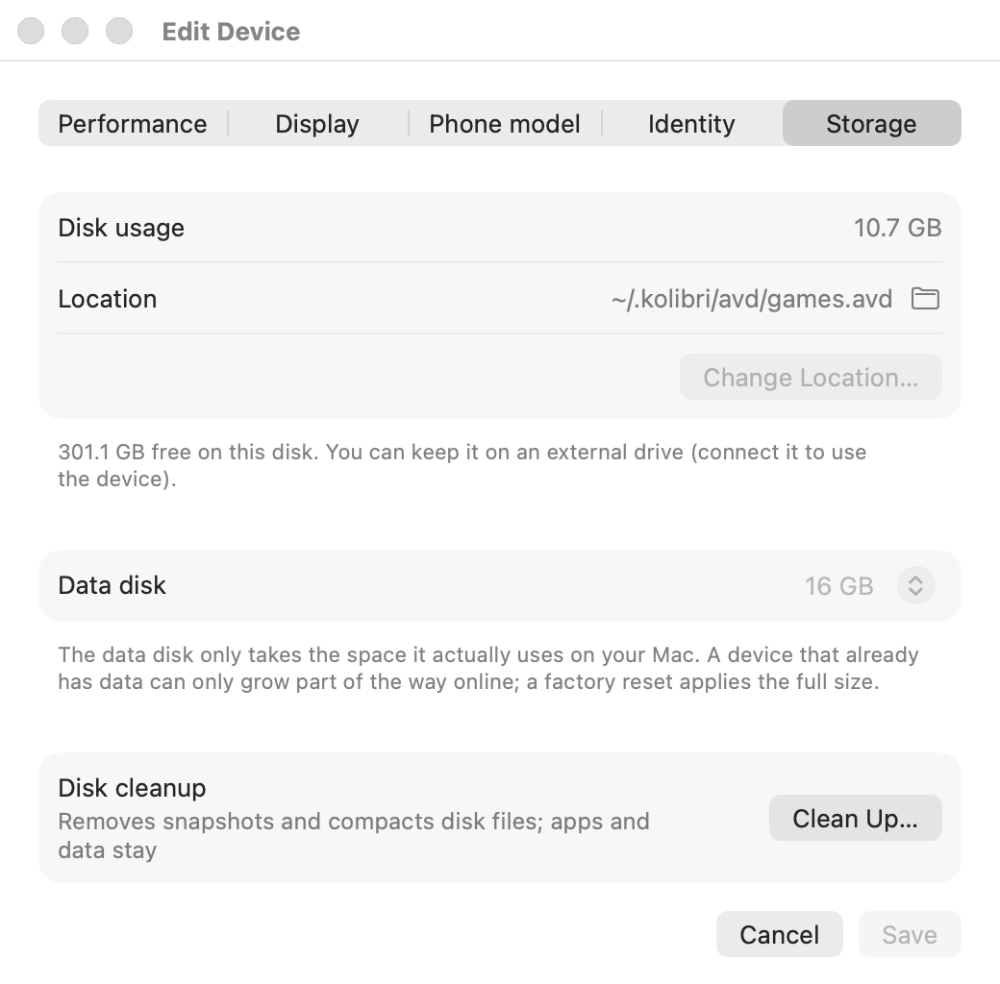
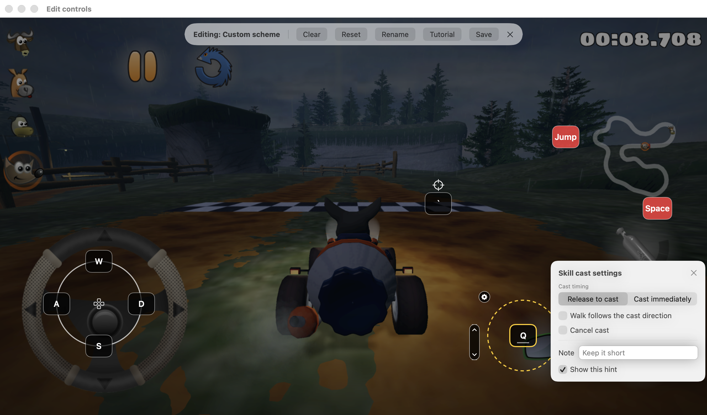
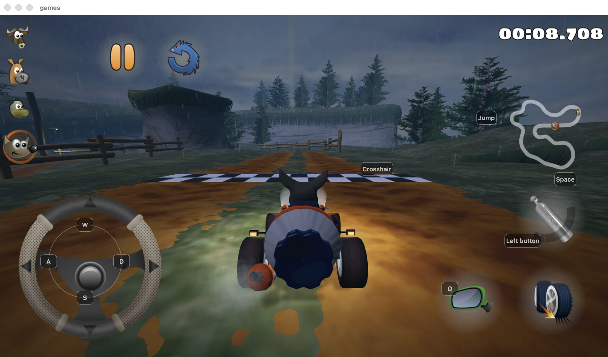
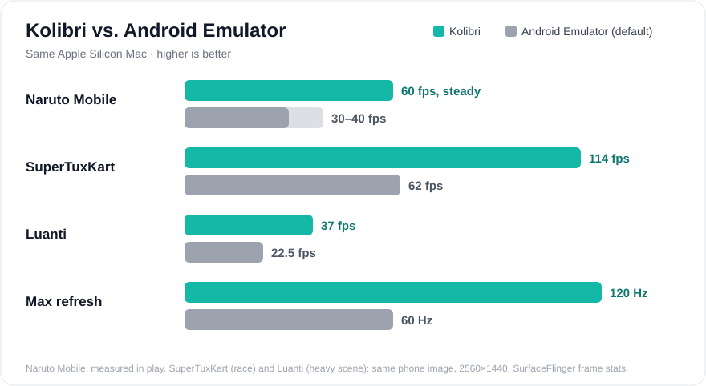

<p align="center">
  
</p>

<h1 align="center">Kolibri</h1>

<p align="center">
  An Android emulator for gaming on Apple Silicon Macs.
</p>

<p align="center">
  <a href="https://github.com/Meinianda-L/kolibri/releases/latest"></a>
  <a href="LICENSE"></a>
  
</p>

<p align="center">
  <a href="#installation">Installation</a> ·
  <a href="#features">Features</a> ·
  <a href="#performance">Performance</a> ·
  <a href="#building-from-source">Building</a> ·
  <a href="README.zh-CN.md">中文</a>
</p>

Kolibri runs Android on your Mac through the open-source Android Emulator engine, using the
Hypervisor framework for the CPU and Vulkan over MoltenVK for graphics. On top of it is a native
SwiftUI app built for playing games: keyboard, mouse and gamepad mapping, up to 120 Hz, several phones
at once, drag-and-drop installs and screen recording.

Both the engine and the Android system can be built from source. The bundled engine is compiled from
the Android Emulator sources, and `tools/aosp` builds Kolibri's own Android 12 image from AOSP on a
Mac: dark UI, the Kolibri launcher as the only home app, no taskbar or nav bar, and phone models
chosen at boot.

<p align="center">
  
</p>

## Installation

```bash
curl -fsSL https://raw.githubusercontent.com/Meinianda-L/kolibri/main/install.sh | bash
```

The script downloads the latest release into `/Applications` and opens it; run it again to update.
You can also download `Kolibri-<version>-macOS-arm64.zip` from
[Releases](https://github.com/Meinianda-L/kolibri/releases/latest). The app isn't notarized, so a
browser download needs `xattr -dr com.apple.quarantine /Applications/Kolibri.app` once.

On first launch Kolibri downloads its own Android 12 system from this project's releases (about
590 MB) and adb from Google (after you accept the Android SDK license). If macOS offers to install the Command Line Tools, accept: Kolibri's
device tool runs on the Python they include.

Requirements: an Apple Silicon Mac, macOS 15 or later, about 10 GB of free disk space.

## Features

**Devices.** Create phones in a few seconds and run several side by side. Each phone has its own
CPU and memory, resolution and refresh rate (up to 120 Hz), phone model and GPU name (games choose
graphics and frame-rate tiers from these), device name, phone number, Android ID and storage location.
Stopping a phone saves a snapshot in the background, and the next start resumes where you left off.

**Controls.** Right-click the game to place controls: taps, bursts, swipe paths, a D-pad or joystick,
mouse look with a crosshair key, skill casting with a range, scroll and zoom keys, tilt and macros.
Each button has a trigger mode (hold, tap, double tap, turbo, toggle, long press), and schemes follow
the game in the foreground.

<p align="center">
  
</p>

**Everything else.** Drag APK, XAPK, APKS or APKM files (with OBB) onto the window to install them,
or any other file to send it to Downloads. Screenshots, screen recording with game audio, an operation
recorder, a shared folder, clipboard sync, a boss key, and a Chinese or English interface.

<table>
  <tr>
    <td width="50%"></td>
    <td width="50%"></td>
  </tr>
  <tr>
    <td width="50%"></td>
    <td width="50%"></td>
  </tr>
</table>

## Performance

Measured on the same Mac and phone image against the Android Emulator with its default settings
(60 Hz display, OpenGL ES translator).

<p align="center">
  
</p>

| | Kolibri | Android Emulator |
|---|---|---|
| Naruto Mobile | 60 fps, steady | 30–40 fps |
| SuperTuxKart, race, 2560×1440 | 114 fps (p99 16 ms) | 62 fps (p99 23 ms) |
| Luanti, heavy scene, 2560×1440 | 37 fps | 22.5 fps |
| Maximum display refresh | 120 Hz | 60 Hz |
| OpenGL ES version reported to games | 3.1 / 3.2 | 3.0 |

Naruto Mobile was measured in play; the other games with SurfaceFlinger frame statistics while the
display was attached.

## How it works

```
Kolibri.app (SwiftUI)  <-- gRPC, shared memory -->  Android Emulator engine  -->  Android 12 (arm64)
  input, keymaps, Metal                             QEMU + HVF, gfxstream          GLES through ANGLE
  recording, settings                               Vulkan -> MoltenVK -> Metal    slimmed system
```

| Path | Contents |
|---|---|
| `app/` | The macOS app (Swift package) |
| `engine/kolibrictl` | Creates, starts, stops, edits and cleans phones; the app drives it |
| `engine/profiles/` | Phone models: brand, model, chip, GPU name, refresh rate |
| `engine/src-patches/` | Patches and exact sources of the bundled engine |
| `engine/slim/` | System packages removed from every phone |
| `guest/` | The in-phone launcher (a Lawnchair fork, built from patches) and wallpaper |
| `tools/aosp/` | Kolibri's own Android 12 image, built from AOSP in a Linux VM on the Mac |

## Building from source

```bash
git clone https://github.com/Meinianda-L/kolibri && cd kolibri/app
swift build && scripts/bundle.sh            # app/build/Kolibri.app
```

`bundle.sh` packages the engine from an engine build (see `engine/src-patches/README.md`) and the
launcher from `guest/launcher/build.sh` when they are present. Phones can also be managed from the
command line:

```bash
engine/kolibrictl setup --accept-licenses
engine/kolibrictl create phone1 --resolution 1920x1080 --refresh 120
engine/kolibrictl provision phone1 && engine/kolibrictl start phone1
```

### Self-built Android system

`tools/aosp` builds a slim Android 12 (AOSP 12L, `android-12.1.0_r27`) for the engine, entirely on an
Apple Silicon Mac: a Lima VM runs the x86_64 build tools through Rosetta. The image is about 590 MB
compressed (the Google image download is 1.9 GB), cold-boots in about 20 s, and every phone model is
built in and picked at boot, so phones need no writable system partition.

```bash
limactl start --name aosp tools/aosp/lima-aosp.yaml && limactl shell aosp sudo bash "$PWD/tools/aosp/vm-setup.sh"
tools/aosp/build.sh                                   # first build: about a day; later ones: minutes
engine/kolibrictl create phone2 --image android-32/kolibri --no-gms
```

The source checkout (about 70 GB) follows `tools/aosp/manifest-android-12.1.0_r27.xml`. Since 0.3.0
new phones use this image; phones created earlier keep Google's Android 16 image.

## License

Kolibri is released under the [MIT License](LICENSE). The launcher in `guest/launcher/` is GPL-3.0,
and the bundled engine keeps the licenses of its sources (QEMU GPL-2.0, most of the rest Apache-2.0);
see [NOTICE](NOTICE). The Android system is built from AOSP (Apache-2.0, kernel GPL-2.0) and published
as a release asset; adb and the older Android 16 image come from Google under the Android SDK License
Agreement.

Kolibri is not affiliated with Google. Android is a trademark of Google LLC.
