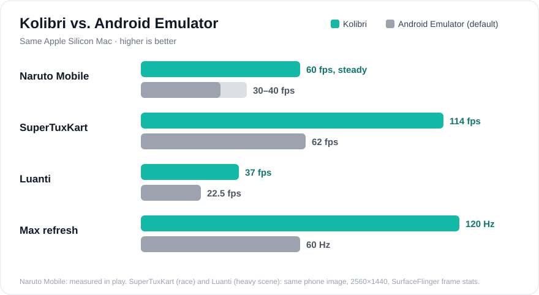
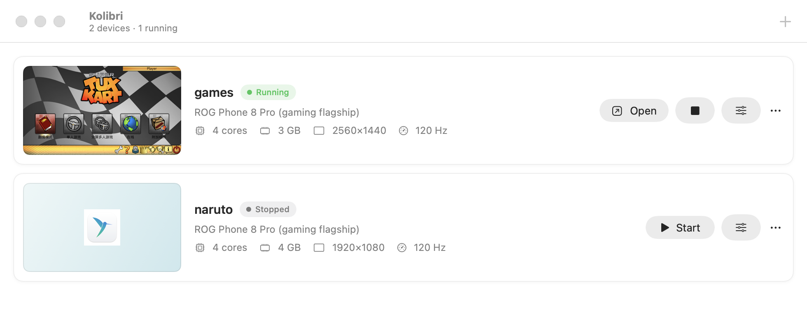
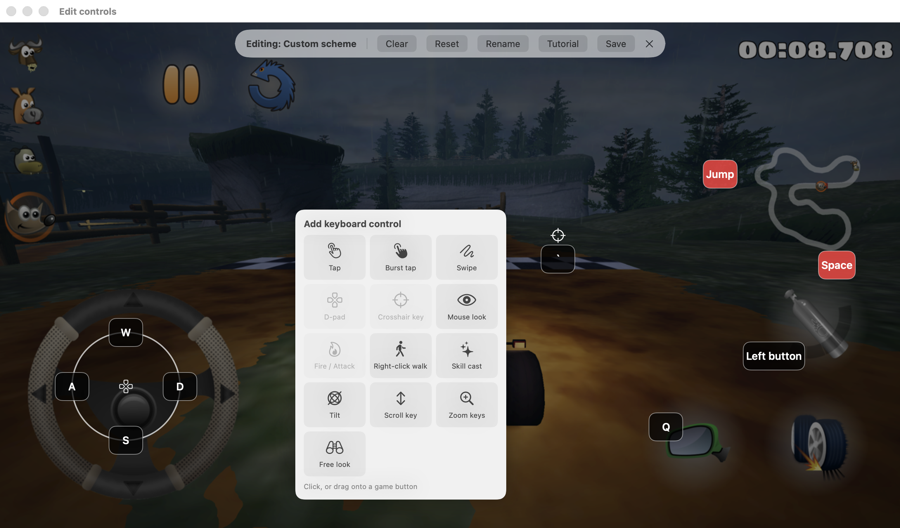
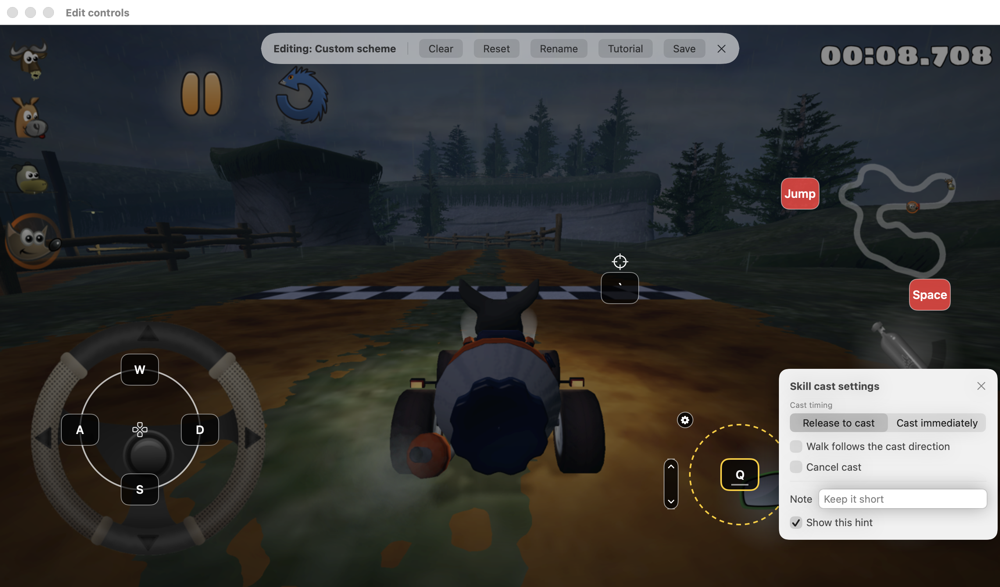
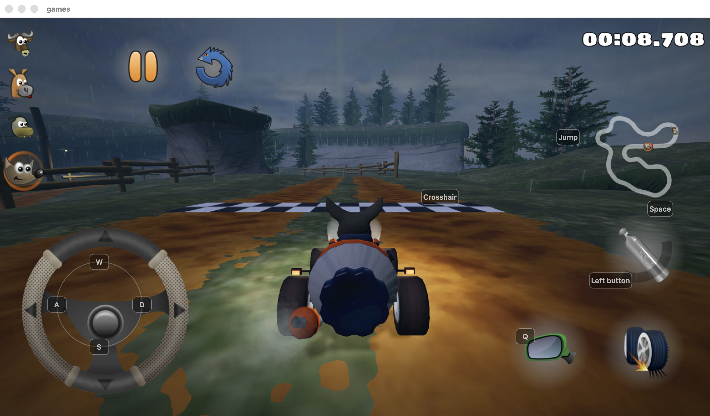
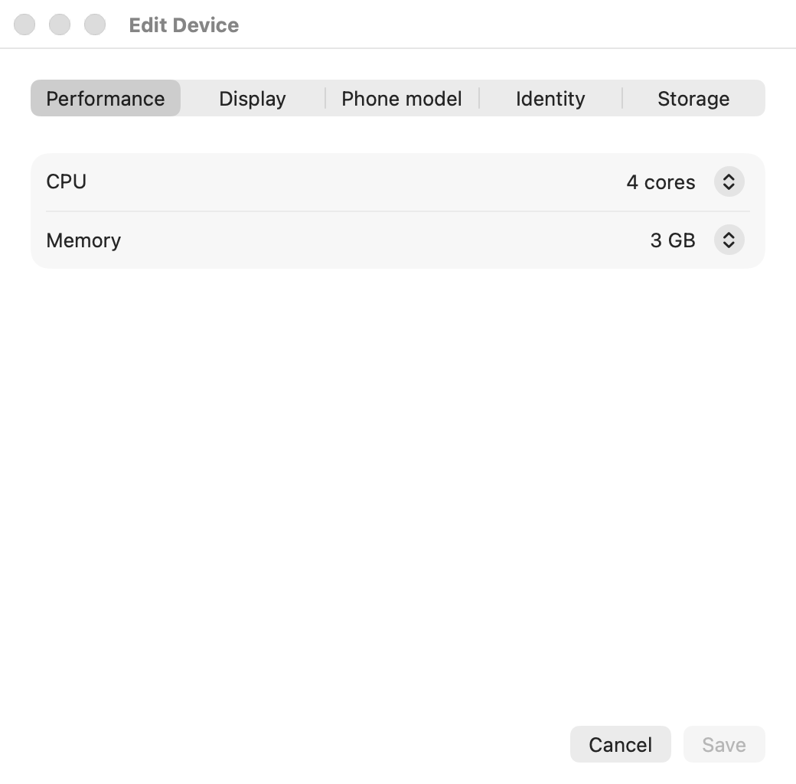
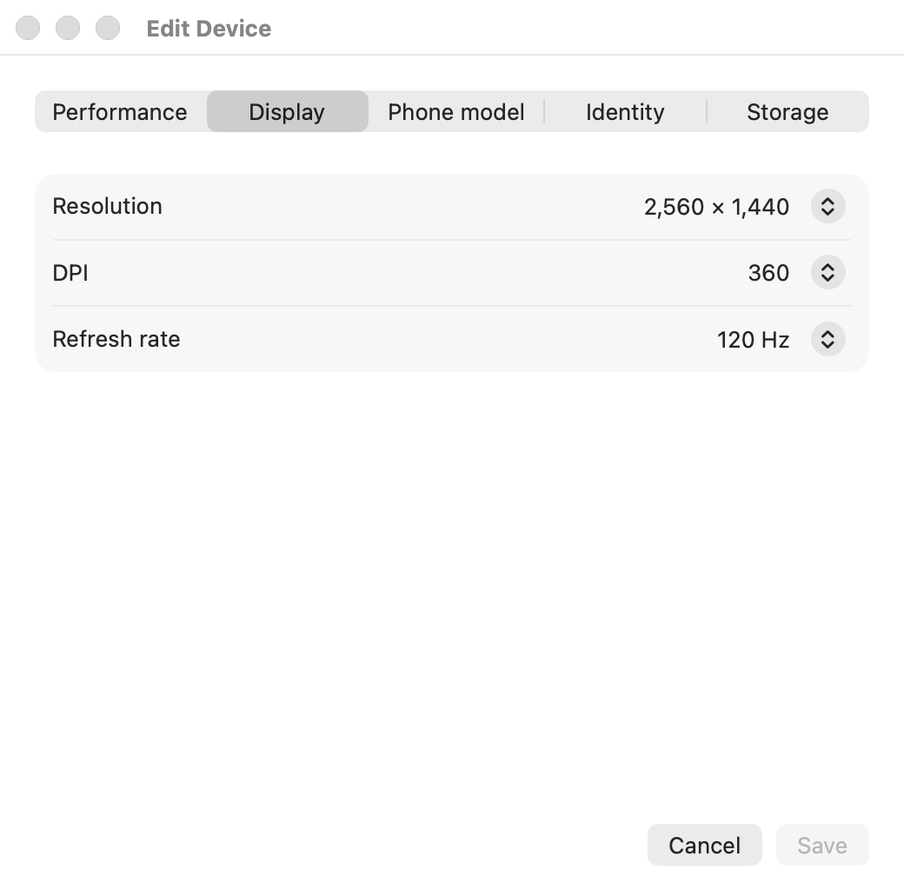
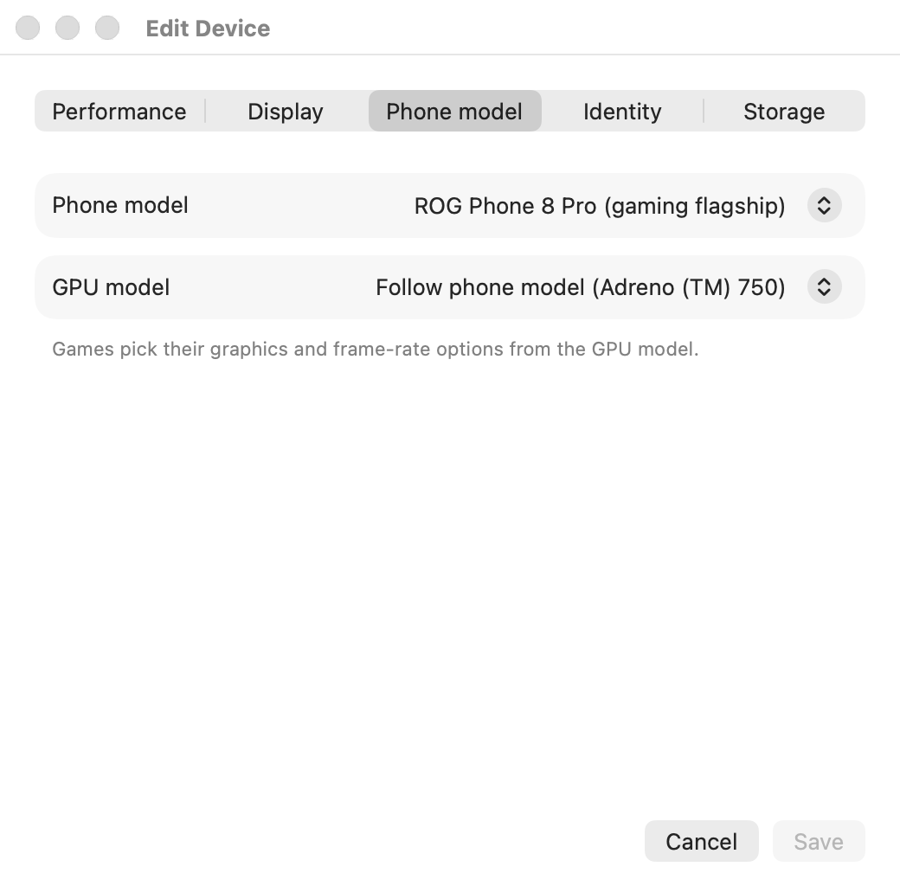
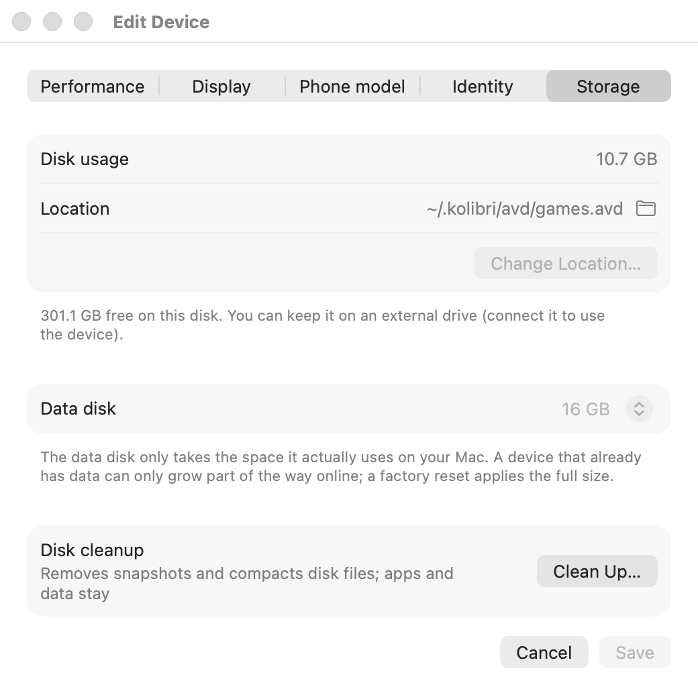

<div align="center">



# Kolibri

### Android gaming on Apple Silicon. Native, fast, 120 Hz.

Play Android games on your Mac with real keyboard, mouse and gamepad controls,<br>
several phones at once, and a UI that feels like a Mac app.

[](https://github.com/Meinianda-L/kolibri/releases/latest)


[](LICENSE)

**[Download](https://github.com/Meinianda-L/kolibri/releases/latest)** · [Benchmarks](#-by-the-numbers) · [Features](#-features) · [Install](#-install) · [How it works](#-how-it-works) · [FAQ](#-faq) · [中文](README.zh-CN.md)

<br>



</div>

<br>

## ✨ Why Kolibri

<table>
<tr>
<td width="33%" valign="top">

### 🎮 Made for games
Keyboard & mouse mapping with a visual editor, gamepad support, mouse-look with a crosshair key,
skill casting, macros, turbo and toggle buttons. Schemes switch with the game in front.

</td>
<td width="33%" valign="top">

### ⚡ Smooth on Apple Silicon
Hardware virtualization (Hypervisor.framework) and Vulkan → MoltenVK → Metal. Up to **120 Hz**
display, 120 fps unlock per game, phones that resume from a snapshot in seconds.

</td>
<td width="33%" valign="top">

### 🍎 A real Mac app
Native SwiftUI, light and dark, Chinese and English. Drag an APK onto the window to install it.
Screenshots, screen recording, a boss key. No ads, no bundled junk.

</td>
</tr>
</table>

## 📊 By the numbers

| | **Kolibri** | Android Emulator (default) |
|---|---|---|
| Naruto Mobile | **60 fps, steady** | 30–40 fps |
| SuperTuxKart (race, 2560×1440) | **114 fps** · p99 16 ms | 62 fps · p99 23 ms |
| Luanti (heavy scene, 2560×1440) | **37 fps** | 22.5 fps |
| Max display refresh | **120 Hz** | 60 Hz |
| GLES version games see | **3.1 / 3.2** (ANGLE inside Android) | 3.0 (host translator on macOS) |
| GPU name games see | **Adreno (TM) 750** or any phone's GPU | “Android Emulator OpenGL ES Translator” |
| Keyboard, mouse & gamepad mapping | **Built in** | — |

Kolibri on its own (2560×1440, M1–M5 Mac):

- **Zero-copy frames** (optional engine build): about **30% less CPU** in the app
- **Stop in about 1 s**; the snapshot is saved in the background, and the next start resumes in seconds

<sub>Same Mac, same phone image. Naruto Mobile was measured in play; SuperTuxKart and Luanti with SurfaceFlinger frame stats while the display was attached. The Android Emulator ran with its default settings (60 Hz, OpenGL ES translator).</sub>

## 🧩 Features

### Your phones, side by side
Every phone is a card with its last screen, state and specs. Click the picture to start it or jump in;
stopping saves a snapshot in the background, so next time you continue right where you left off.

<p align="center"></p>

### Keyboard, mouse & gamepad mapping
Right-click the game to drop a control on it. Tap, burst, swipe paths, D-pad / joystick, mouse look,
skill cast with range, scroll, zoom, tilt and macros. Every button has a trigger mode: hold, tap,
double tap, turbo, toggle, long press.

<p align="center"></p>

<table>
<tr>
<td width="50%"><p align="center"><sub>Fine-tune any control</sub></p></td>
<td width="50%"><p align="center"><sub>Key hints while you play</sub></p></td>
</tr>
</table>

### Tune every phone
Phone model and GPU decide which graphics and frame-rate tiers games offer, so each phone can look like
a gaming flagship. Resolution, DPI, refresh rate, CPU and memory are per phone too.

<table>
<tr>
<td width="50%"><p align="center"><sub>Performance</sub></p></td>
<td width="50%"><p align="center"><sub>Display: up to 120 Hz</sub></p></td>
</tr>
<tr>
<td width="50%"><p align="center"><sub>Phone model & GPU</sub></p></td>
<td width="50%"><p align="center"><sub>Storage: move, grow, clean up</sub></p></td>
</tr>
</table>

### Everything else you'd expect

| | |
|---|---|
| 📦 **Drag & drop installs** | APK, XAPK, APKS, APKM (with OBB); other files go to Android Downloads |
| 🛒 **Game store built in** | An open-source store and a browser on every phone; Google Play services available |
| 🎬 **Capture** | Screenshots, screen recording (HEVC/H.264 with game audio), operation recorder & replay |
| 🗂 **Shared folder & clipboard** | Move files and text between macOS and Android |
| 🆔 **Device identity** | Device name, phone number, Android ID, optional root for apps |
| 💾 **Storage control** | Per-phone data disk size, location (external drives too) and one-click cleanup |
| 🌐 **Bilingual** | Chinese and English UI, switch any time in Settings |

## 🚀 Install

1. **Download** `Kolibri-<version>-macOS-arm64.zip` from [Releases](https://github.com/Meinianda-L/kolibri/releases/latest), unzip it and drag
   **Kolibri.app** to Applications.
2. **Open it once with right-click → Open** (the app isn't notarized yet). If macOS still refuses:
   System Settings → Privacy & Security → **Open Anyway**.
3. **First launch** downloads Google's Android Emulator engine and the Android 16 system image (≈ 2.3 GB,
   once) after you accept the Android SDK license. If macOS asks for the **Command Line Tools**, accept them.
4. Click **New Device** → **Start**, then grab games from the built-in store or drop an APK on the window.

> [!NOTE]
> Requires an Apple Silicon Mac (M1–M5), macOS 15+, and about 10 GB of free space.
> Already using Android Studio? Kolibri picks up its SDK in `~/Library/Android/sdk`.

## 🛠 How it works

```
┌──────────────────────────┐   gRPC + shared memory   ┌───────────────────────────────┐
│  Kolibri.app (SwiftUI)   │ ◀──────── frames ──────── │  Android Emulator engine      │
│  keymaps · input · Metal │ ───────── input ────────▶ │  qemu + HVF · gfxstream       │
│  recording · settings    │                           │  Vulkan → MoltenVK → Metal    │
└──────────────────────────┘                           └──────────────┬────────────────┘
                                                                      │
                                                       ┌──────────────▼────────────────┐
                                                       │  Android 16 (arm64)           │
                                                       │  GLES via ANGLE · own launcher│
                                                       └───────────────────────────────┘
```

| Path | What's inside |
|---|---|
| [`app/`](app) | The macOS app (Swift Package): device manager, game window, keymap engine, recorder |
| [`engine/kolibrictl`](engine/kolibrictl) | Creates, starts, stops, edits and cleans phones; the app drives it, so can you |
| [`engine/profiles/`](engine/profiles) | Phone models: brand, model, chip, GPU name, refresh rate |
| [`engine/glshim/`](engine/glshim) | Small shims in front of MoltenVK / ANGLE (the GPU name games see) |
| [`engine/src-patches/`](engine/src-patches) | Engine patches: zero-copy IOSurface frames, host-side GLES |
| [`guest/`](guest) | The in-phone launcher (a Lawnchair fork built from patches) and wallpaper |

### Build from source

```bash
git clone https://github.com/Meinianda-L/kolibri && cd kolibri
cd app && swift build && scripts/bundle.sh        # → app/build/Kolibri.app
```

Prefer the terminal?

```bash
engine/kolibrictl setup --accept-licenses         # download the Android parts
engine/kolibrictl create phone1 --resolution 1920x1080 --refresh 120 --profile flagship-120
engine/kolibrictl provision phone1 && engine/kolibrictl start phone1
```

## ❓ FAQ

<details>
<summary><b>Which games run?</b></summary>

Most games that support ARM64 Android. GLES games run through ANGLE inside Android and Vulkan games go
straight to MoltenVK. 32-bit-only games and titles with strict anti-cheat that refuses emulators won't run.
</details>

<details>
<summary><b>Why does the first launch download 2.3 GB?</b></summary>

The Android engine and system image are Google's and come under the Android SDK license, so Kolibri
fetches them from Google's servers (pinned versions, checksum-verified) instead of shipping them.
</details>

<details>
<summary><b>macOS says the app can't be opened.</b></summary>

It isn't notarized yet. Right-click → Open, or System Settings → Privacy & Security → Open Anyway, or run
`xattr -dr com.apple.quarantine /Applications/Kolibri.app`.
</details>

<details>
<summary><b>Where are my phones stored?</b></summary>

In `~/.kolibri`. Each phone can be moved to any folder or an external drive from Edit Device → Storage.
</details>

## 📄 License

[MIT](LICENSE) (exceptions in [NOTICE](NOTICE)). The in-phone launcher (`guest/launcher/`, a Lawnchair fork) is GPL-3.0, and the engine
patches keep their upstream licenses (QEMU: GPL-2.0, gfxstream: Apache-2.0). The Android parts downloaded on
first launch are Google's, under the Android SDK License Agreement.

## 📌 Status

Kolibri is a personal project in active development: feedback and issues are welcome.
Not affiliated with Google or any phone maker. Android is a trademark of Google LLC.

<div align="center"><sub>Made with ❤️ for people who game on a Mac.</sub></div>
