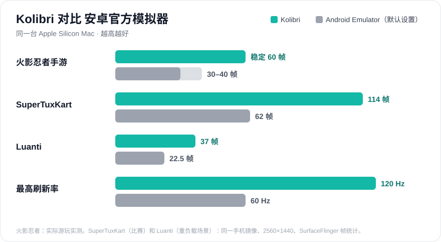
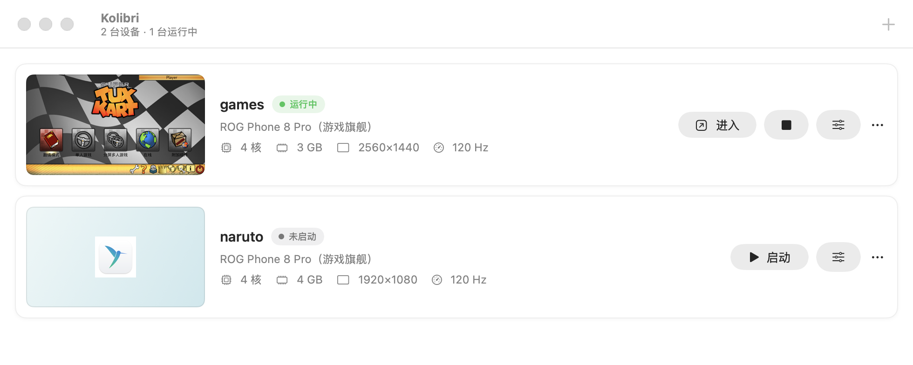
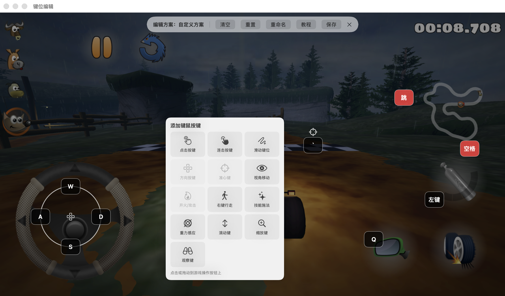
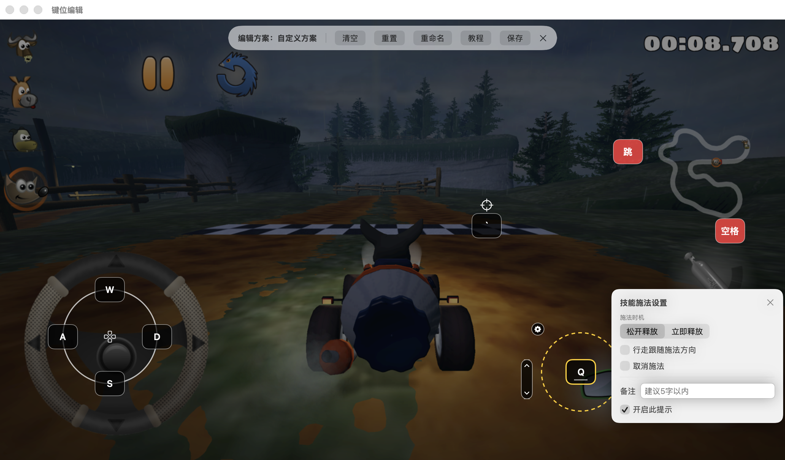
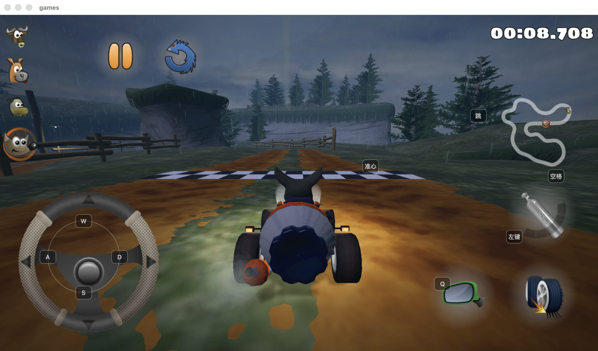
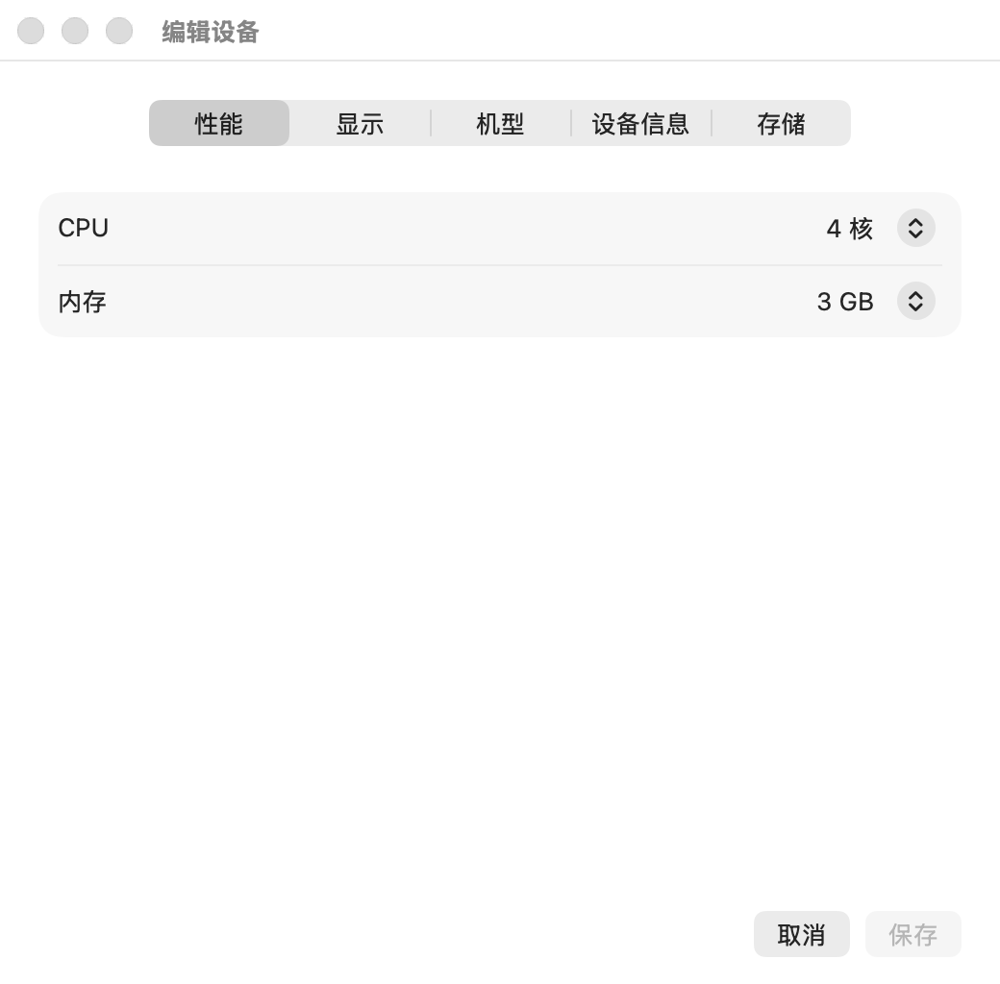
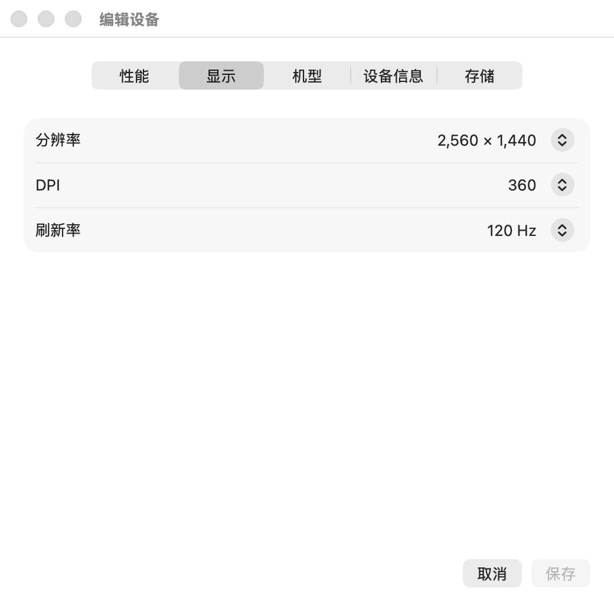
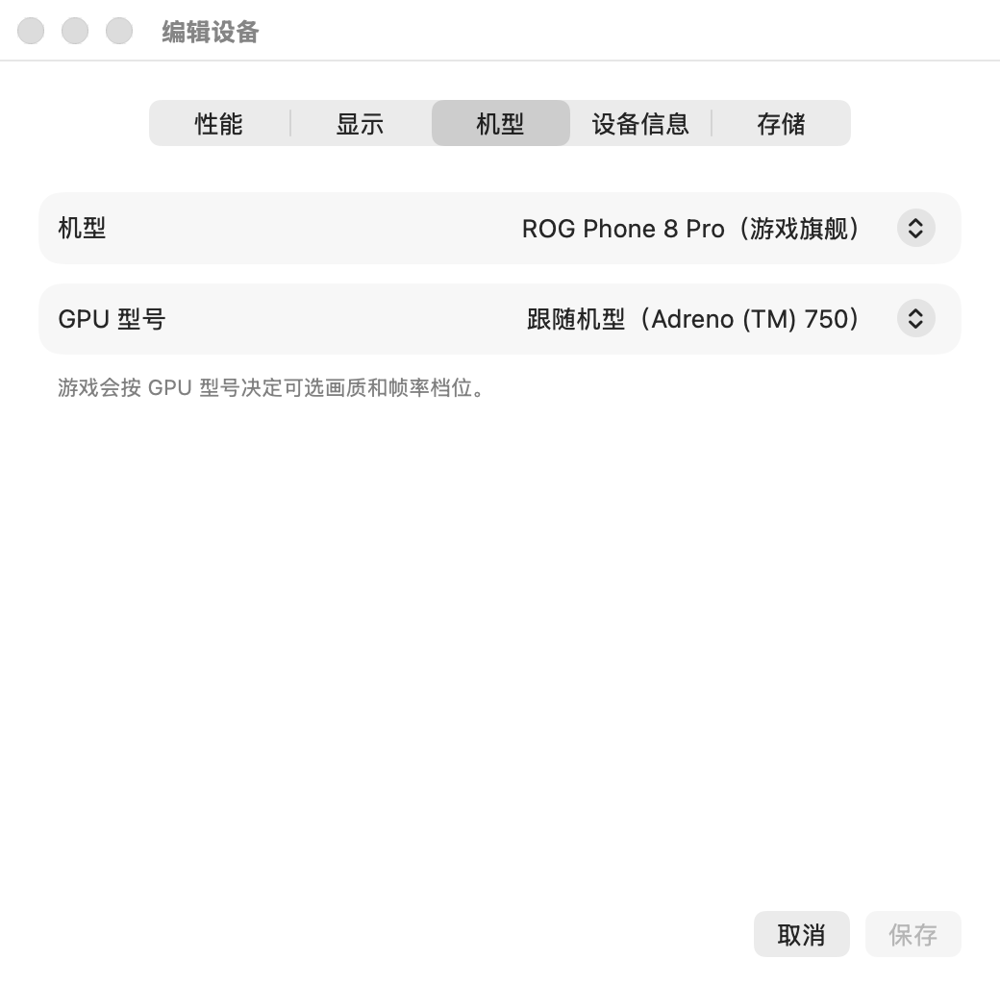
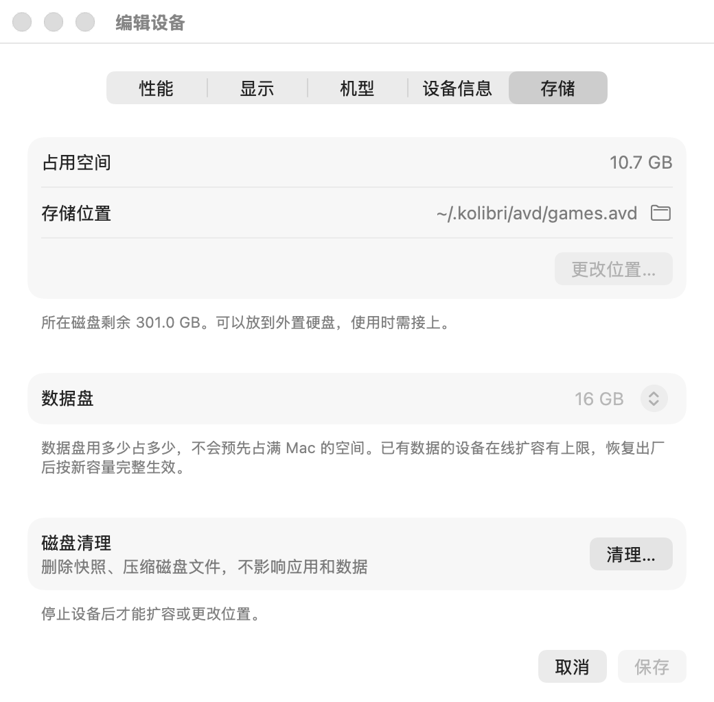

<div align="center">


# Kolibri 蜂鸟模拟器

### Apple Silicon Mac 上的安卓游戏模拟器：原生、流畅、120 Hz

在 Mac 上用键鼠和手柄玩安卓游戏，多台手机同时开，界面就是一个地道的 Mac 程序。

[](https://github.com/Meinianda-L/kolibri/releases/latest)


[](LICENSE)

**[下载](https://github.com/Meinianda-L/kolibri/releases/latest)** · [亮点](#-为什么选-kolibri) · [实测数据](#-实测数据) · [功能](#-功能) · [安装](#-安装) · [原理](#-工作原理) · [常见问题](#-常见问题) · [English](README.md)

<br>



</div>

<br>

## ✨ 为什么选 Kolibri

<table>
<tr>
<td width="33%" valign="top">

### 🎮 为游戏而生
可视化键位编辑器、手柄支持、准心键视角移动、技能施法、宏、连发和开关按键，方案跟随前台游戏自动切换。

</td>
<td width="33%" valign="top">

### ⚡ Apple Silicon 上够流畅
硬件虚拟化（Hypervisor.framework）+ Vulkan → MoltenVK → Metal。最高 **120 Hz** 显示，游戏 120 帧解锁，快照秒开。

</td>
<td width="33%" valign="top">

### 🍎 地道的 Mac 程序
原生 SwiftUI，浅色深色都好看，中英文界面。把 APK 拖进窗口就安装，截图、录屏、老板键。无广告、无捆绑。

</td>
</tr>
</table>

## 📊 实测数据

| | **Kolibri** | 安卓官方模拟器（默认设置） |
|---|---|---|
| 火影忍者手游 | **稳定 60 帧** | 30–40 帧 |
| SuperTuxKart（比赛，2560×1440） | **114 帧** · p99 16 ms | 62 帧 · p99 23 ms |
| Luanti（重负载场景，2560×1440） | **37 帧** | 22.5 帧 |
| 最高画面刷新率 | **120 Hz** | 60 Hz |
| 游戏看到的 GLES 版本 | **3.1 / 3.2**（安卓内 ANGLE） | 3.0（macOS 上的宿主翻译层） |
| 游戏看到的 GPU | **Adreno (TM) 750** 或任意机型的 GPU | “Android Emulator OpenGL ES Translator” |
| 键鼠、手柄映射 | **内置** | — |

Kolibri 自身（2560×1440，M1–M5 Mac）：

- **零拷贝出帧**（可选引擎）：程序 CPU 占用降低约 **30%**
- **约 1 秒停止**：快照在后台保存，下次启动几秒内接着玩

<sub>同一台 Mac、同一个手机镜像。火影忍者为实际游玩实测；SuperTuxKart 和 Luanti 用 SurfaceFlinger 帧统计、连接显示端测得。官方模拟器使用默认设置（60 Hz、OpenGL ES 翻译层）。</sub>

## 🧩 功能

### 多台手机，一目了然
每台手机一张卡片，显示上次画面、状态和配置。点画面就能启动或进入；停止时快照在后台保存，下次接着玩。

<p align="center"></p>

### 键鼠、手柄映射
在游戏画面上点右键添加按键：点击、连击、滑动轨迹、方向键/摇杆、视角移动、技能施法（可调范围）、滚动、缩放、重力感应和宏。
每个按键都能选触发方式：按住、单点、双击、连发、开关、长按。

<p align="center"></p>

<table>
<tr>
<td width="50%"><p align="center"><sub>每个按键都能细调</sub></p></td>
<td width="50%"><p align="center"><sub>游戏中的按键提示</sub></p></td>
</tr>
</table>

### 每台手机单独调
游戏会按机型和 GPU 决定可选的画质和帧率档位，每台手机都可以伪装成游戏旗舰。分辨率、DPI、刷新率、CPU 和内存也都能单独设置。

<table>
<tr>
<td width="50%"><p align="center"><sub>性能</sub></p></td>
<td width="50%"><p align="center"><sub>显示：最高 120 Hz</sub></p></td>
</tr>
<tr>
<td width="50%"><p align="center"><sub>机型与 GPU</sub></p></td>
<td width="50%"><p align="center"><sub>存储：移动、扩容、清理</sub></p></td>
</tr>
</table>

### 该有的都有

| | |
|---|---|
| 📦 **拖拽安装** | APK、XAPK、APKS、APKM（含 OBB）；其他文件自动传到安卓「下载」 |
| 🛒 **自带应用商店** | 每台手机都有开源应用商店和浏览器，可用 Google Play 服务 |
| 🎬 **截图与录制** | 截图、录屏（HEVC/H.264，含游戏声音）、操作录制与回放 |
| 🗂 **共享文件夹与剪贴板** | 在 macOS 和安卓之间传文件、传文字 |
| 🆔 **设备信息** | 设备名称、手机号、Android ID、可选的应用 root |
| 💾 **存储管理** | 每台手机的数据盘大小、存放位置（支持外置硬盘）、一键清理 |
| 🌐 **中英双语** | 中文 / English 界面，随时在设置里切换 |

## 🚀 安装

1. 在 [Releases](https://github.com/Meinianda-L/kolibri/releases/latest) **下载** `Kolibri-<版本>-macOS-arm64.zip`，解压后把 **Kolibri.app** 拖进「应用程序」。
2. **第一次请右键 → 打开**（程序还没有经过苹果公证）。如果系统仍然拦截：「系统设置 → 隐私与安全性」→ **仍要打开**。
3. **首次启动**在同意 Android SDK 许可协议后，从 Google 下载安卓模拟器引擎和安卓 16 系统镜像（约 2.3 GB，只需一次）。
   如果系统提示安装**命令行开发者工具**，请同意。
4. 点 **新建设备** → **启动**，然后从自带商店下载游戏，或把 APK 拖进窗口。

> [!NOTE]
> 需要 Apple Silicon Mac（M1–M5）、macOS 15+，以及约 10 GB 可用空间。
> 已经装了 Android Studio？Kolibri 会直接使用 `~/Library/Android/sdk` 里的 SDK。

## 🛠 工作原理

```
┌──────────────────────────┐   gRPC + 共享内存        ┌───────────────────────────────┐
│  Kolibri.app (SwiftUI)   │ ◀──────── 画面 ────────── │  Android Emulator 引擎        │
│  键位 · 输入 · Metal     │ ───────── 输入 ─────────▶ │  qemu + HVF · gfxstream       │
│  录制 · 设置             │                           │  Vulkan → MoltenVK → Metal    │
└──────────────────────────┘                           └──────────────┬────────────────┘
                                                                      │
                                                       ┌──────────────▼────────────────┐
                                                       │  安卓 16 (arm64)              │
                                                       │  GLES 由 ANGLE 处理 · 自带桌面│
                                                       └───────────────────────────────┘
```

| 目录 | 内容 |
|---|---|
| [`app/`](app) | macOS 程序（Swift Package）：设备管理、游戏窗口、键位引擎、录制 |
| [`engine/kolibrictl`](engine/kolibrictl) | 新建、启动、停止、编辑、清理手机；程序调用它，你也可以直接用 |
| [`engine/profiles/`](engine/profiles) | 手机机型：品牌、型号、芯片、GPU 名称、刷新率 |
| [`engine/glshim/`](engine/glshim) | MoltenVK / ANGLE 前的小垫片（游戏看到的 GPU 名称） |
| [`engine/src-patches/`](engine/src-patches) | 引擎补丁：IOSurface 零拷贝出帧、宿主侧 GLES |
| [`guest/`](guest) | 手机里的桌面（基于 Lawnchair，用补丁构建）和壁纸 |

### 从源码编译

```bash
git clone https://github.com/Meinianda-L/kolibri && cd kolibri
cd app && swift build && scripts/bundle.sh        # → app/build/Kolibri.app
```

更喜欢命令行？

```bash
engine/kolibrictl setup --accept-licenses         # 下载安卓组件
engine/kolibrictl create phone1 --resolution 1920x1080 --refresh 120 --profile flagship-120
engine/kolibrictl provision phone1 && engine/kolibrictl start phone1
```

## ❓ 常见问题

<details>
<summary><b>能玩哪些游戏？</b></summary>

支持 ARM64 安卓的大多数游戏。GLES 游戏经安卓内的 ANGLE 运行，Vulkan 游戏直接走 MoltenVK。只有 32 位版本的游戏，以及反作弊明确拒绝模拟器的游戏无法运行。
</details>

<details>
<summary><b>为什么第一次启动要下载 2.3 GB？</b></summary>

安卓引擎和系统镜像属于 Google，受 Android SDK 许可协议约束，所以 Kolibri 从 Google 官方服务器下载（固定版本、校验文件），而不是打包在程序里。
</details>

<details>
<summary><b>macOS 提示无法打开？</b></summary>

程序还没有经过公证。右键 → 打开，或「系统设置 → 隐私与安全性 → 仍要打开」，也可以运行 `xattr -dr com.apple.quarantine /Applications/Kolibri.app`。
</details>

<details>
<summary><b>手机数据存在哪里？</b></summary>

在 `~/.kolibri`。每台手机都可以在「编辑设备 → 存储」里移到任意文件夹或外置硬盘。
</details>

## 📄 许可证

[MIT](LICENSE)（例外见 [NOTICE](NOTICE)）。手机里的桌面（`guest/launcher/`，基于 Lawnchair）为 GPL-3.0，引擎补丁沿用上游许可（QEMU：GPL-2.0，gfxstream：Apache-2.0）。
首次启动下载的安卓组件属于 Google，受 Android SDK 许可协议约束。

## 📌 状态

个人项目，仍在积极开发中，欢迎反馈和提 issue。与 Google 及任何手机厂商无关。Android 是 Google LLC 的商标。

<div align="center"><sub>献给在 Mac 上玩游戏的你 ❤️</sub></div>
