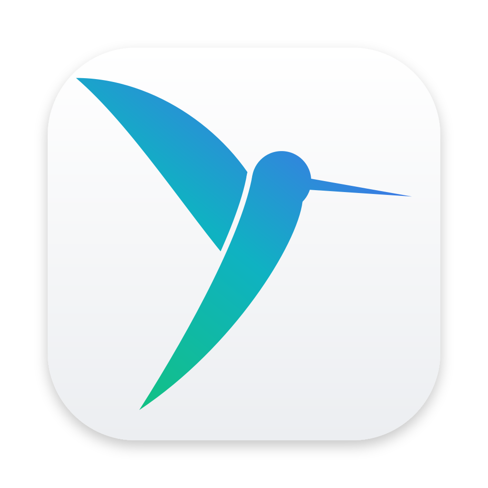
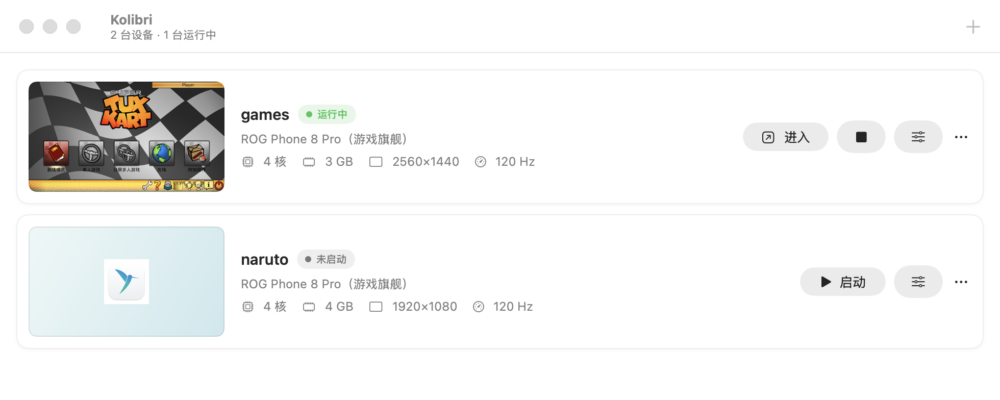
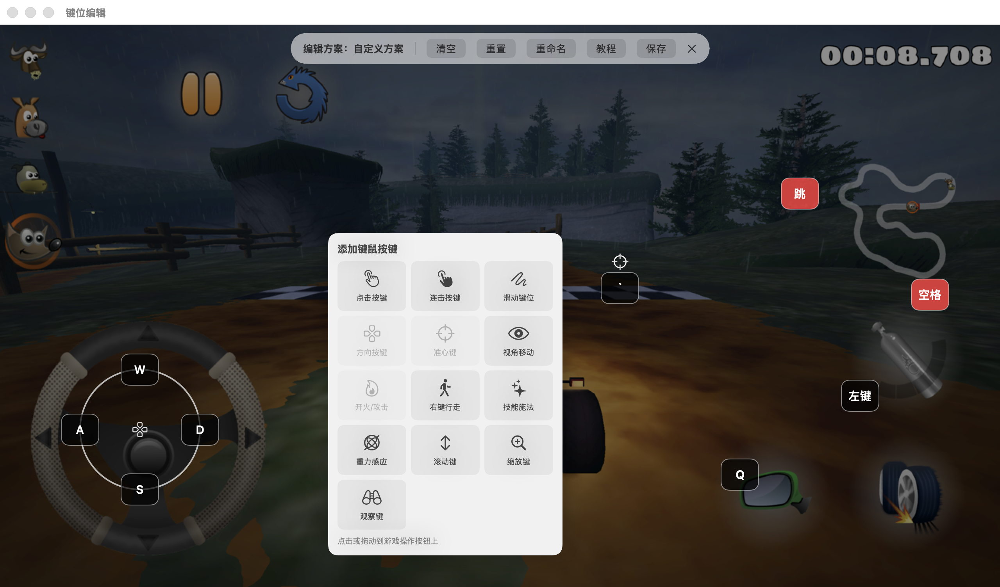
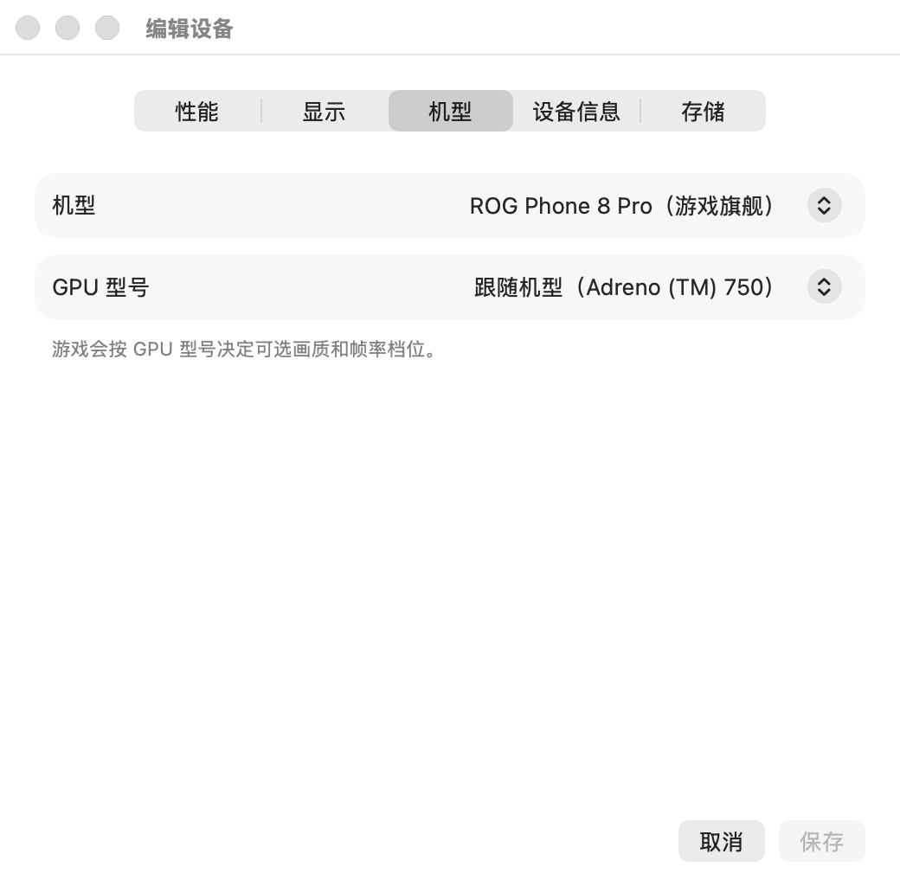
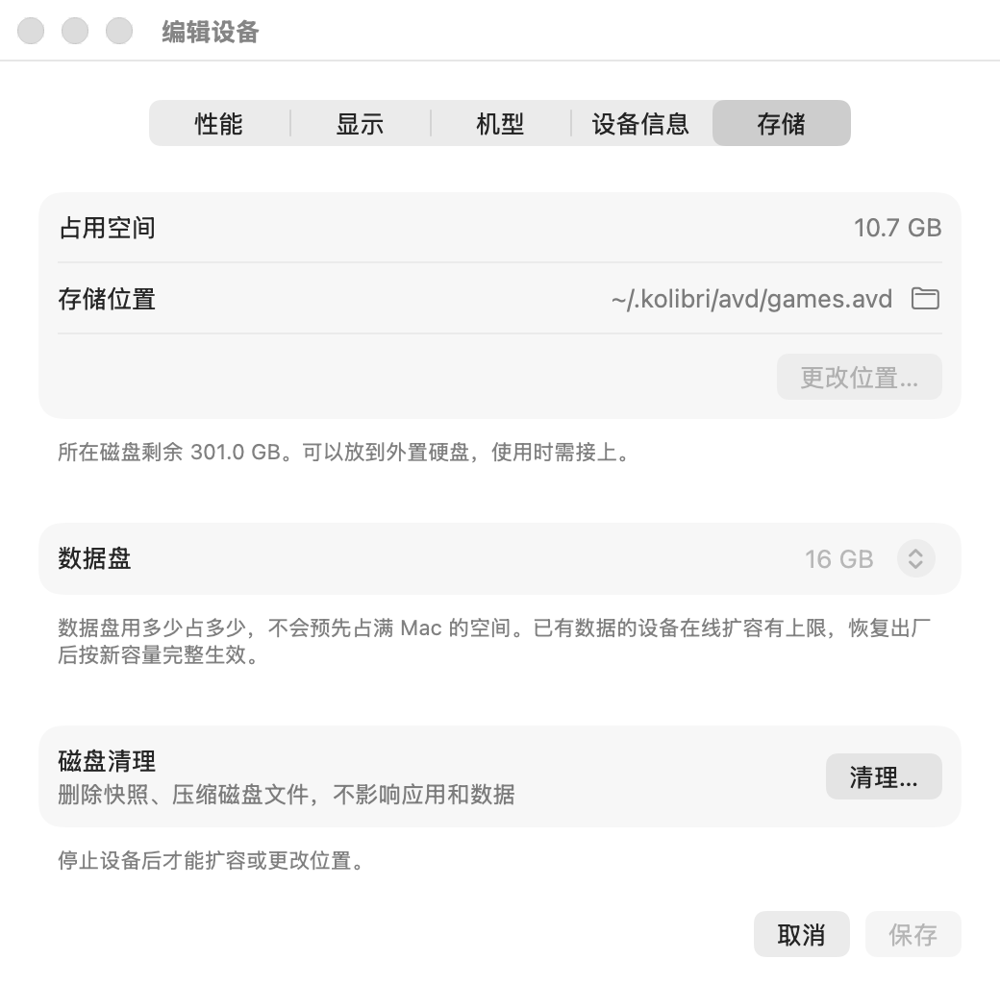
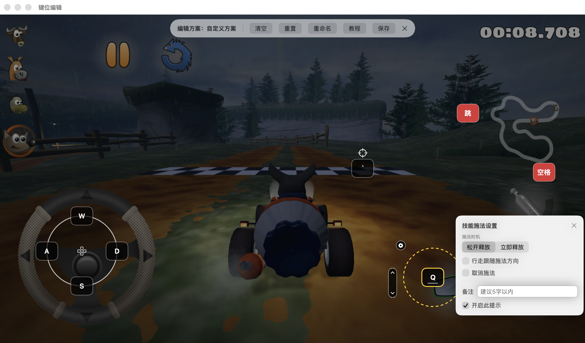
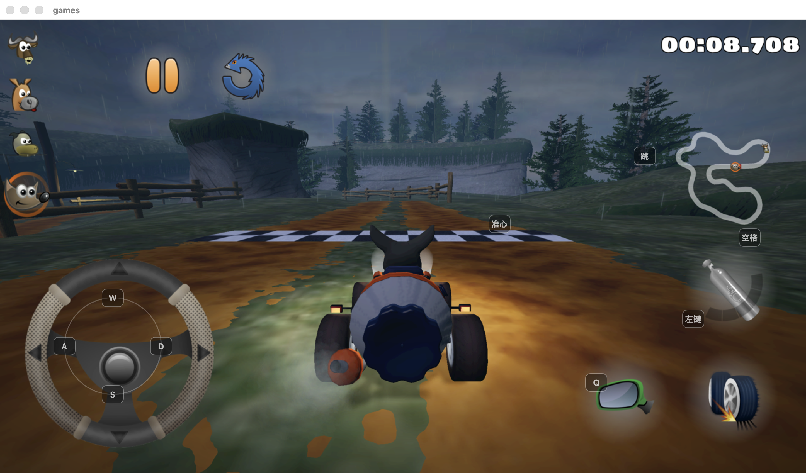
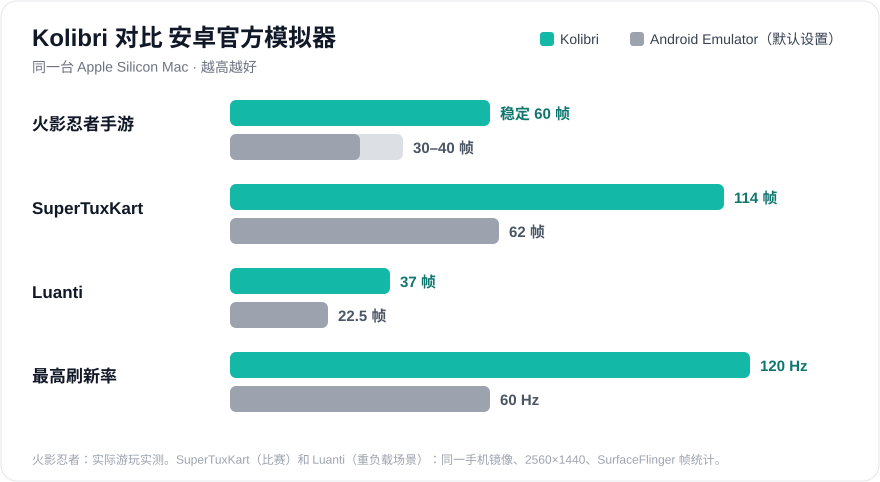

<p align="center">
  
</p>

<h1 align="center">Kolibri 蜂鸟模拟器</h1>

<p align="center">
  Apple Silicon Mac 上用来玩游戏的安卓模拟器。
</p>

<p align="center">
  <a href="https://github.com/Meinianda-L/kolibri/releases/latest"></a>
  <a href="LICENSE"></a>
  
</p>

<p align="center">
  <a href="#安装">安装</a> ·
  <a href="#功能">功能</a> ·
  <a href="#性能">性能</a> ·
  <a href="#从源码编译">编译</a> ·
  <a href="README.md">English</a>
</p>

Kolibri 基于开源的 Android Emulator 引擎在 Mac 上运行安卓 16：CPU 用 Hypervisor 框架虚拟化，图形走
Vulkan → MoltenVK → Metal。外层是一个为玩游戏做的原生 SwiftUI 程序：键鼠和手柄映射、最高 120 Hz、多台手机同时运行、
拖拽安装和录屏。

<p align="center">
  
</p>

## 安装

```bash
curl -fsSL https://raw.githubusercontent.com/Meinianda-L/kolibri/main/install.sh | bash
```

脚本会把最新版本装到「应用程序」并打开，再运行一次即可更新。也可以在
[Releases](https://github.com/Meinianda-L/kolibri/releases/latest) 下载 `Kolibri-<版本>-macOS-arm64.zip`。
程序没有经过苹果公证，用浏览器下载的需要先运行一次 `xattr -dr com.apple.quarantine /Applications/Kolibri.app`。

首次启动时，同意 Android SDK 许可协议后会从 Google 下载安卓 16 系统镜像（约 1.9 GB）。如果系统提示安装命令行开发者工具，
请同意：Kolibri 的设备管理工具使用其中的 Python。

系统要求：Apple Silicon Mac、macOS 15 及以上、约 10 GB 可用空间。

## 功能

**设备。** 几秒新建一台手机，可以同时运行多台。每台手机都能单独设置 CPU 和内存、分辨率和刷新率（最高 120 Hz）、
机型和 GPU 名称（游戏据此决定画质和帧率档位）、设备名称、手机号、Android ID 和存储位置。停止时快照在后台保存，下次启动接着玩。

**操作。** 在游戏画面上点右键放置按键：点击、连击、滑动轨迹、方向键或摇杆、准心键视角移动、带范围的技能施法、滚动键、
缩放键、重力感应和宏。每个按键都能选触发方式（按住、单点、双击、连发、开关、长按），方案跟随前台游戏切换。

<p align="center">
  
</p>

**其他。** 把 APK、XAPK、APKS、APKM（含 OBB）拖到窗口上即可安装，其他文件会传到安卓「下载」。还有截图、带游戏声音的录屏、
操作录制、共享文件夹、剪贴板同步、老板键，以及中文和英文界面。

<table>
  <tr>
    <td width="50%"></td>
    <td width="50%"></td>
  </tr>
  <tr>
    <td width="50%"></td>
    <td width="50%"></td>
  </tr>
</table>

## 性能

在同一台 Mac、同一个手机镜像上，与默认设置的官方 Android Emulator（60 Hz、OpenGL ES 翻译层）对比。

<p align="center">
  
</p>

| | Kolibri | Android Emulator |
|---|---|---|
| 火影忍者手游 | 稳定 60 帧 | 30–40 帧 |
| SuperTuxKart，比赛，2560×1440 | 114 帧（p99 16 ms） | 62 帧（p99 23 ms） |
| Luanti，重负载场景，2560×1440 | 37 帧 | 22.5 帧 |
| 最高画面刷新率 | 120 Hz | 60 Hz |
| 游戏看到的 OpenGL ES 版本 | 3.1 / 3.2 | 3.0 |

火影忍者为实际游玩实测，其余游戏用 SurfaceFlinger 帧统计、连接显示端测得。

## 工作原理

```
Kolibri.app (SwiftUI)  <-- gRPC、共享内存 -->  Android Emulator 引擎       -->  安卓 16 (arm64)
  输入、键位、Metal                            QEMU + HVF、gfxstream            GLES 由 ANGLE 处理
  录制、设置                                   Vulkan -> MoltenVK -> Metal      精简系统
```

| 目录 | 内容 |
|---|---|
| `app/` | macOS 程序（Swift Package） |
| `engine/kolibrictl` | 新建、启动、停止、编辑、清理手机，程序通过它管理设备 |
| `engine/profiles/` | 手机机型：品牌、型号、芯片、GPU 名称、刷新率 |
| `engine/src-patches/` | 内置引擎的补丁和准确的源码版本 |
| `engine/slim/` | 每台手机都会移除的系统组件 |
| `guest/` | 手机里的桌面（基于 Lawnchair，用补丁构建）和壁纸 |

## 从源码编译

```bash
git clone https://github.com/Meinianda-L/kolibri && cd kolibri/app
swift build && scripts/bundle.sh            # app/build/Kolibri.app
```

有引擎编译结果（见 `engine/src-patches/README.md`）和桌面 APK（`guest/launcher/build.sh`）时，`bundle.sh` 会一起打包。
也可以用命令行管理手机：

```bash
engine/kolibrictl setup --accept-licenses
engine/kolibrictl create phone1 --resolution 1920x1080 --refresh 120
engine/kolibrictl provision phone1 && engine/kolibrictl start phone1
```

## 许可证

Kolibri 以 [MIT 许可证](LICENSE) 发布。`guest/launcher/` 中的桌面为 GPL-3.0，内置引擎沿用其源码的许可证（QEMU 为 GPL-2.0，
其余大多为 Apache-2.0），详见 [NOTICE](NOTICE)。安卓系统镜像从 Google 下载，受 Android SDK 许可协议约束，不包含在本仓库中。

Kolibri 与 Google 无关。Android 是 Google LLC 的商标。
